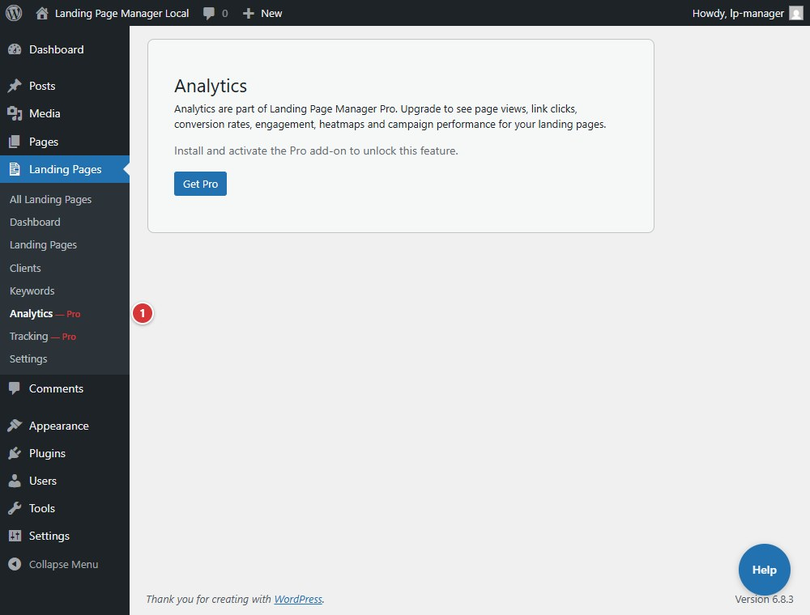

<!-- fragment: analytics -->
<!-- screenshot: analytics.jpg -->

# Analytics

**Landing Pages > Analytics** opens the plugin's analytics screen. Without the separate Pro add-on, core displays an upgrade notice instead of reports and collects no analytics by itself.

## Steps

1. Open **Landing Pages > Analytics**.
2. If Pro is not active, read the notice. There are no analytics controls on the core-only screen.
3. When Pro is active, use the **Client** and **Template** filters and the report tabs: **Overview**, **By Client**, **By Page**, **By Template**, **Link Performance**, **Engagement**, **Heatmap**, and **Rage Clicks**.

1. Select **Analytics** in the Landing Pages menu to open this Pro-gated screen.

## Next

[Conversion Tracking](settings-conversion-tracking)
