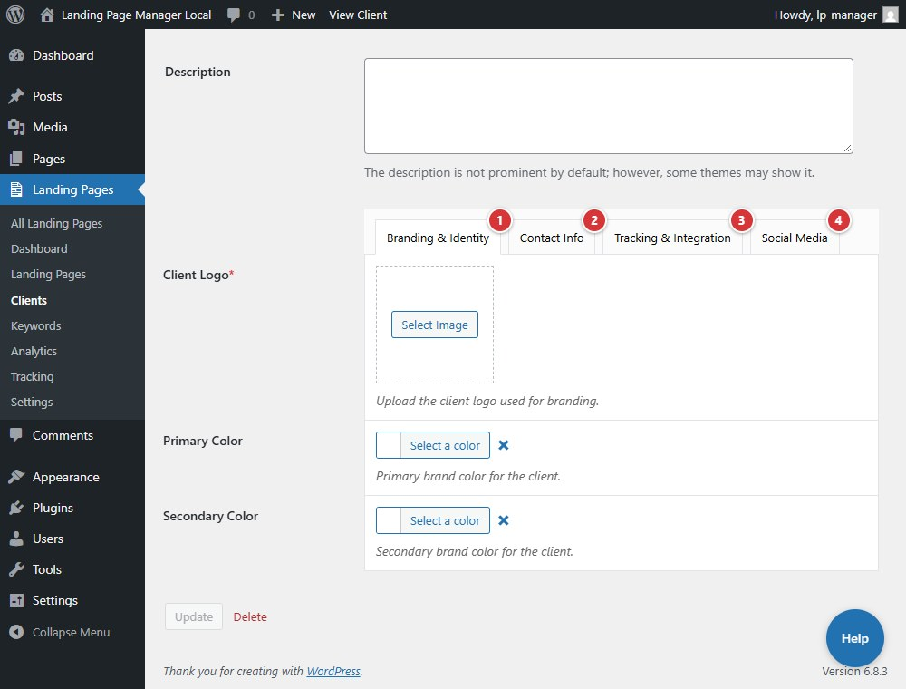

<!-- fragment: client-editor -->
<!-- screenshot: client-editor.jpg -->

# Client editor

The client editor stores branding, contact defaults, subdomain slug, tracking options, and social links used by the client's landing pages.

## Steps

1. Open a client from **Landing Pages > Clients**.
2. Use **Branding & Identity**, **Contact Info**, **Tracking & Integration**, and **Social Media** to edit its fields.
3. Select **Update** to save the client.

**Client Logo**, **Contact Address**, **Contact Phone**, and **Client Domain** are required. **Latitude**, **Longitude**, **Google Place ID**, and **Google Search URL** are read-only. A landing page's optional **Page phone** overrides the client's **Contact Phone** on that page.

Only users allowed to post unfiltered HTML can change **Header tracking code (call tracking, pixels, tags)**. Tick **Tracking tags need jQuery** if this client's tags require jQuery.

1. Open **Branding & Identity**.
2. Open **Contact Info**.
3. Open **Tracking & Integration**.
4. Open **Social Media**.

## Next

[Keywords](keywords)
