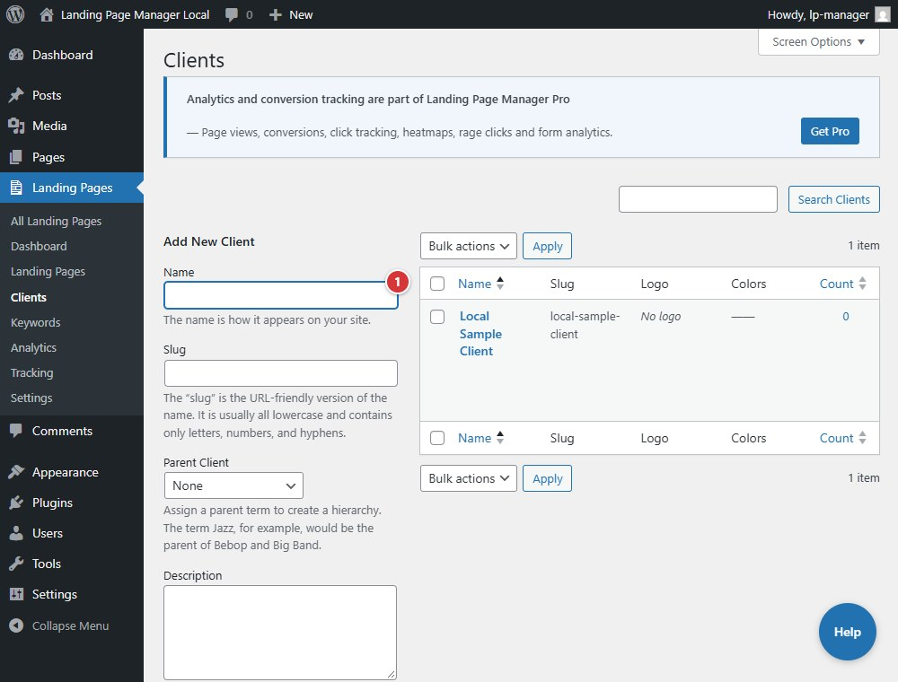

<!-- fragment: clients -->
<!-- screenshot: clients.jpg -->

# Clients

## What this screen is

**Landing Pages → Clients** is the client taxonomy screen. The **Add New Client** form begins with the client **Name**; the client record also holds branding, contact information, tracking settings, and social links.

## Steps

1. Enter a client name in **Name**.
2. Complete the client details, then select **Add New Client**.
3. Select a client's name in the list to open its editor. The list shows **Slug**, **Logo**, and **Colors**.

1. Enter a client name in **Name**.

The client slug is used as the subdomain label. Your DNS and hosting must route the subdomain to this WordPress site; the plugin does not configure DNS or HTTPS.

## Next

[Client editor](client-editor)
