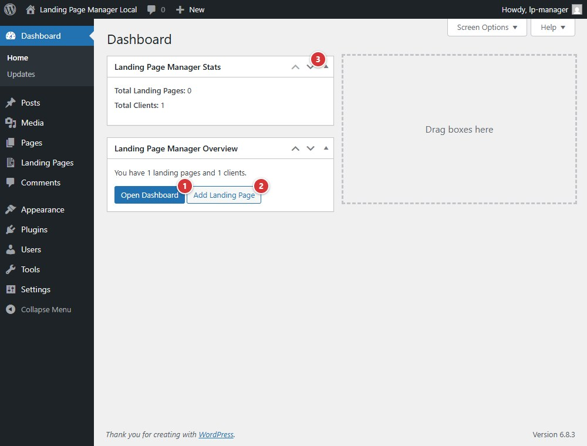

<!-- fragment: dashboard-widgets -->
<!-- screenshot: dashboard-widgets.jpg -->

# WordPress Dashboard widgets

The WordPress Dashboard includes a Landing Page Manager Overview widget and a Landing Page Manager Stats widget. They summarize page and client counts and provide shortcuts into the plugin.

## Steps

1. Open **Dashboard > Home** in wp-admin.
2. Select **Open Dashboard** to open Landing Page Manager's dashboard.
3. Select **Add Landing Page** to start a new landing page.
4. Read **Landing Page Manager Stats** for the total landing-page and client counts.

1. **Open Dashboard** opens the plugin dashboard.
2. **Add Landing Page** opens the landing-page editor.
3. Collapse or expand the **Landing Page Manager Stats** widget.

## Next

[Landing Pages Dashboard](dashboard)
