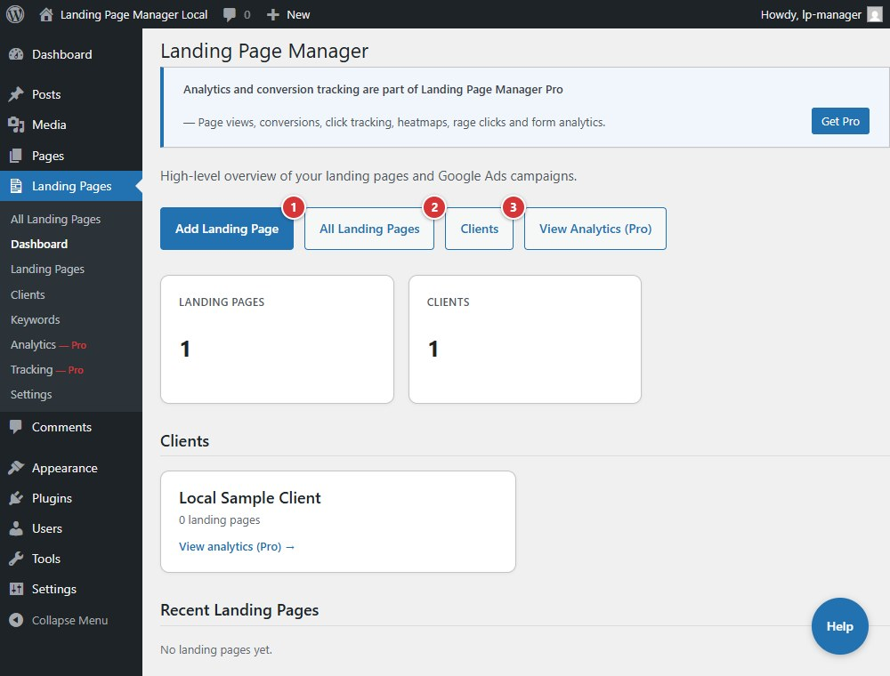

<!-- fragment: dashboard -->
<!-- screenshot: dashboard.jpg -->

# Dashboard

The Landing Pages Dashboard summarizes your landing pages and clients, lists recent pages, and links to common tasks. Pro tracking totals appear only when Pro tracking is active.

## Steps

1. Open **Landing Pages → Dashboard**.
2. Select **Add Landing Page** to create a page, **All Landing Pages** to open the page list, or **Clients** to manage client records.
3. Use the Landing Pages submenu to open **Keywords**, **Analytics**, and **Settings**.

1. **Add Landing Page** opens the landing-page editor.
2. **All Landing Pages** opens the page list.
3. **Clients** opens the client list.

## Next

[Templates](settings-templates)
