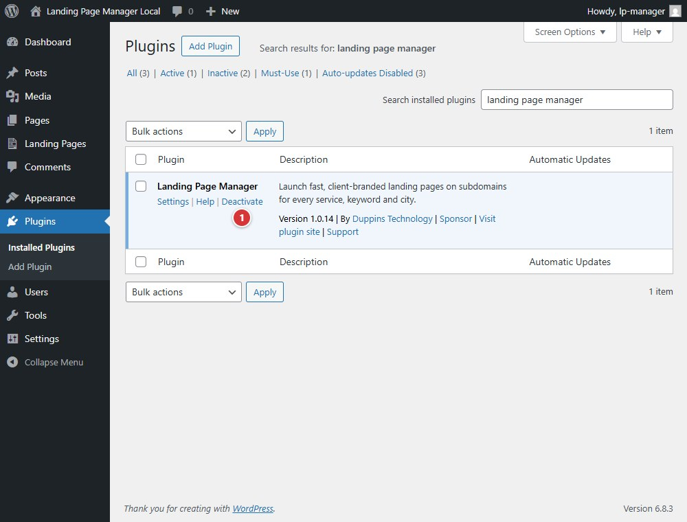

<!-- fragment: deactivate -->
<!-- screenshot: deactivate.jpg -->

# Deactivate

Deactivate Landing Page Manager on the WordPress Plugins screen when you want to stop it running. Deactivation is separate from deleting the plugin.

## Steps

1. Open **Plugins > Installed Plugins**.
2. Select **Deactivate** under Landing Page Manager.

Deactivation does not run the uninstall routine or delete plugin data. If you later select **Delete**, WordPress removes the plugin settings and keeps Landing Pages, Clients, and Keywords by default. To delete those content records too, define `LPMANAGER_UNINSTALL_DELETE_CONTENT` as `true` in `wp-config.php` before deleting. The plugin does not ask whether to keep or delete data when deactivated.

1. **Deactivate** turns off the plugin without deleting its settings or content.

## Next

[Home](Home)
