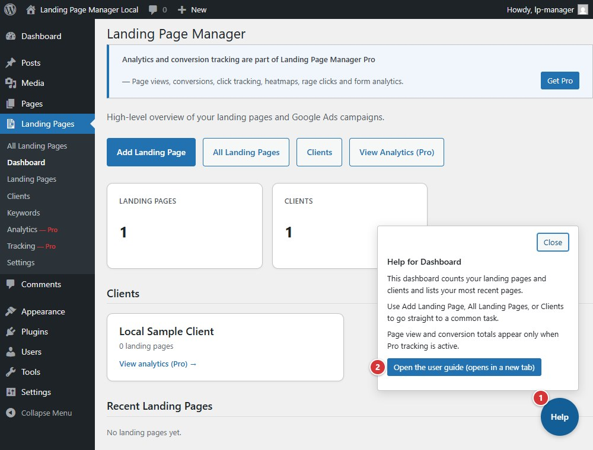

<!-- fragment: help-button -->
<!-- screenshot: help-button.jpg -->

# Help button

On Landing Page Manager admin screens, **Help** is in the upper-right corner of the page. Its **Landing Page Manager** tab links to the guide article for the current screen.

## Steps

1. Select **Help** in the upper-right corner.
2. Select the **Landing Page Manager** tab.
3. Select **Open the user guide**. It opens `https://duppinstech.com/landing-page-manager/guide/` with the current screen's fragment. The WordPress Dashboard opens `#dashboard-widgets`, the Landing Pages Dashboard opens `#dashboard`, and Settings follows the selected tab.

1. **Help** opens the contextual Help panel.
2. **Open the user guide** opens the guide for the current screen.

## Next

[Dashboard](dashboard)
