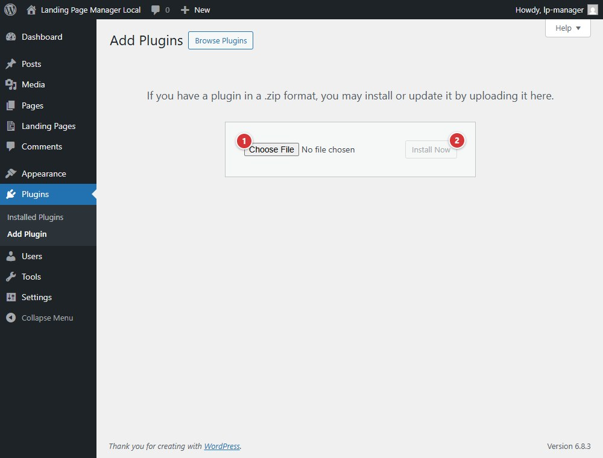

<!-- fragment: install -->
<!-- screenshot: install.jpg -->

# Install

Install and activate the official release ZIP from the WordPress Plugins screen. The plugin header requires WordPress 5.9 or later and PHP 7.4 or later.

## Steps

1. Open **Plugins > Add Plugin**, then select **Upload Plugin**.
2. Select the `landing-page-manager.zip` asset from the official GitHub release, then select **Install Now**.
3. When WordPress finishes installing it, select **Activate Plugin**.

The ZIP must contain a top-level `landing-page-manager/` folder with `landing-page-manager.php` inside it. If you install from a source checkout instead, run `composer install` in the plugin directory before activation.

1. **Choose File** selects the release ZIP `landing-page-manager.zip` from your computer.
2. Select **Install Now** after choosing the ZIP to install it.

## Next

[Help button](help-button)
