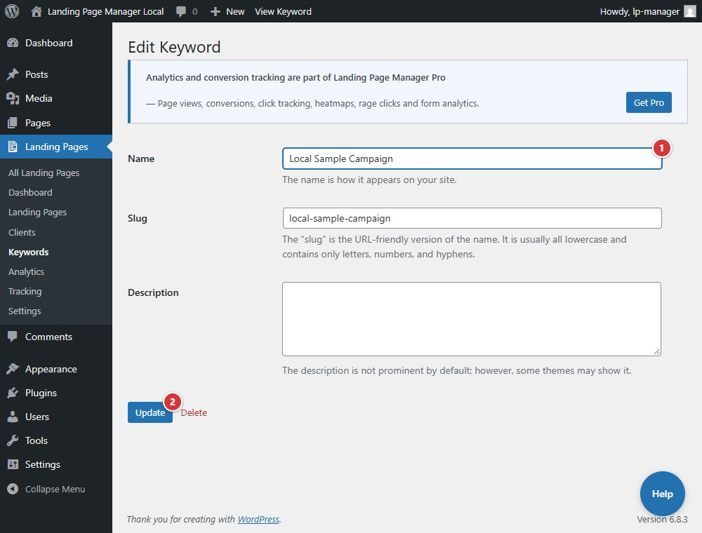

<!-- fragment: keyword-editor -->
<!-- screenshot: keyword-editor.jpg -->

# Keyword editor

The Keyword editor is WordPress's term-edit screen for a selected keyword. Use it to change the term's name, slug, or description.

## Steps

1. Open **Landing Pages > Keywords** and select **Edit** under a keyword.
2. Change **Name**, **Slug**, or **Description**.
3. Select **Update** to save the keyword.

1. **Name** changes the keyword label.
2. **Update** saves the edited keyword.

## Next

[Landing Pages](landing-pages)
