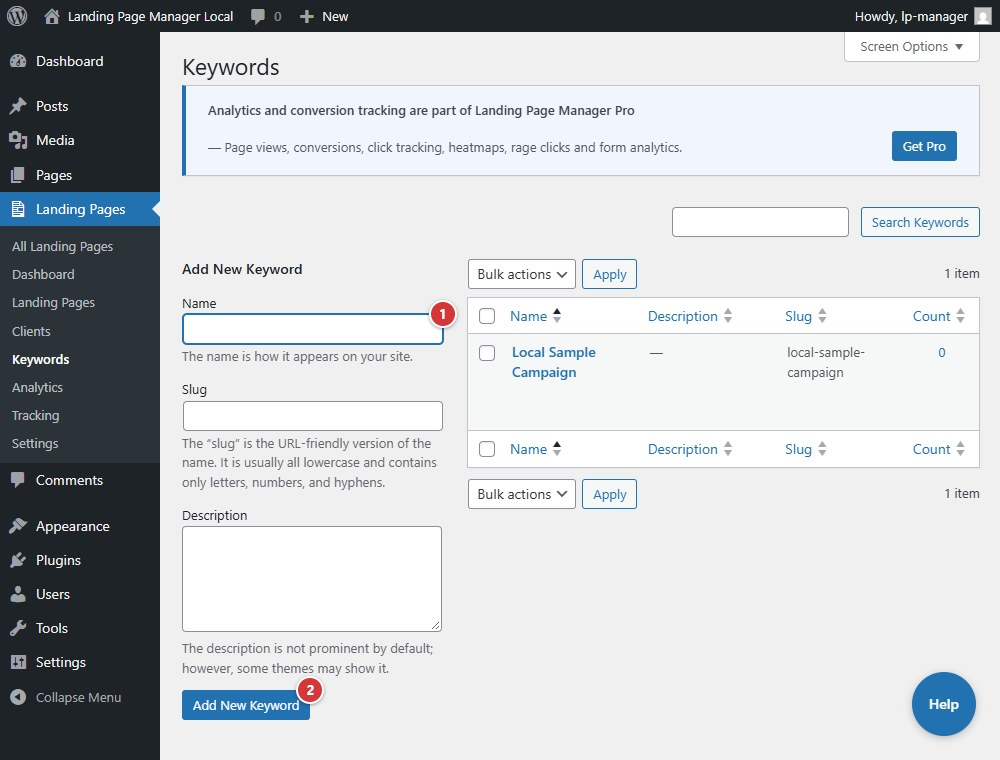

<!-- fragment: keywords -->
<!-- screenshot: keywords.jpg -->

# Keywords

## What this screen is

**Landing Pages → Keywords** is the taxonomy list and add form for campaign or topic labels used to organize Landing Pages.

## Steps

1. Enter a keyword in **Name**.
2. Select **Add New Keyword** to add it to the list.

1. Enter a keyword in **Name**.
2. Select **Add New Keyword** to add it to the list.

## Next

[Keyword editor](keyword-editor)
