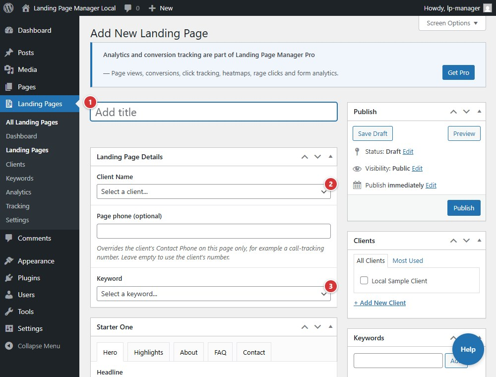

<!-- fragment: landing-page-editor -->
<!-- screenshot: landing-page-editor.jpg -->

# Landing Page editor

The editor combines the WordPress title with shared Landing Page Details and fields for the active site-wide template. The template builds the published layout; this is not a general page builder.

## Steps

1. Select **Add New Landing Page**, enter a title, or select a page title in the list to edit it.
2. In **Landing Page Details**, choose **Client Name** and **Keyword**. Optionally set **Page phone (optional)** to override the client's **Contact Phone** for this page.
3. Complete the fields for the active template, then save as a draft or select **Publish**.
4. Review the generated URL in the Landing Pages list and test it on the client subdomain.

Client, keyword, a usable phone number, and the active template's required fields are needed before a page can be published or scheduled. If any are missing, the plugin saves the page as a draft and lists each missing field with its tab. The list stays until the fields are filled in. An already-published page is not unpublished; it shows the same list. **Preview** opens the page on the main site, where you are logged in, not on the client subdomain.

Template fields vary. Template B has **Hero**, **Trust Bar**, **Opening**, **Reviews**, **Icon Boxes**, **Service Area**, **Roads & Highways**, **FAQ**, and **Closing**. Template C has **Hero**, **Company**, **Benefits**, **More**, and **Apply Now**. Template A has **Layout**, **Header & branding**, **Hero**, **Trust bar & strips**, **Intro (near me)**, **Services grid**, **Stats row**, **Feature / roadside**, **CTA banner**, **Service area**, **FAQ**, **Footer**, and **Advanced**.

With Template B active, **Reviews > Fetch Reviews** retrieves reviews using the Google Maps server key. Each client's reviews can be fetched once every 10 minutes. The field help describes the permitted embed providers.

1. **Title** supplies the page's path slug.
2. **Client Name** assigns the page to a client.
3. **Keyword** assigns the campaign or search term.

## Next

[Analytics](analytics)
