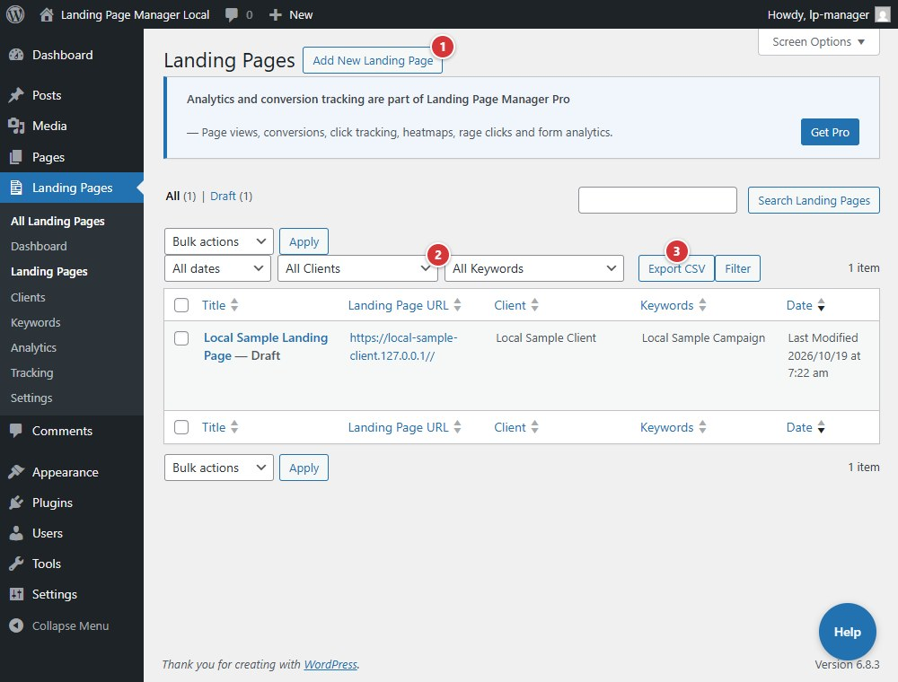

<!-- fragment: landing-pages -->
<!-- screenshot: landing-pages.jpg -->

# Landing Pages

## What this screen is

**Landing Pages → Landing Pages** lists the plugin's landing-page records. The list includes client, keyword, date, and generated **Landing Page URL** columns, plus **Export CSV**.

## Steps

1. Select **Add New Landing Page** to open the editor.
2. Use the **All Clients** and **All Keywords** filters, then select **Filter** to narrow the list.
3. Administrators can select **Export CSV** to download the matching pages as `landing-pages-export.csv`. It contains titles, URLs, clients, keywords, and publish dates; it does not import pages.
4. After publishing, review the generated **Landing Page URL**, **Client**, and **Keywords** columns. Use **Quick Edit** to change a page's client or keyword without opening the full editor.

1. **Add New Landing Page** opens the page editor.
2. The **All Clients** dropdown filters the page list by client.
3. **Export CSV** downloads the filtered list for administrators.

If a page was kept as a draft because required fields are missing (after Quick Edit, bulk edit or a scheduled publish), a notice above the list links to it.

## Next

[Landing Page editor](landing-page-editor)
