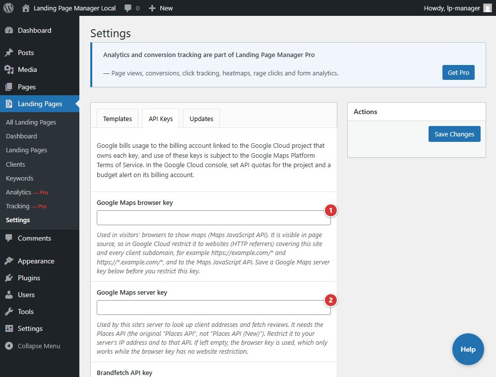

<!-- fragment: settings-api-keys -->
<!-- screenshot: api-keys.jpg -->

# Settings: API Keys

**Landing Pages > Settings > API Keys** stores optional Google Maps browser and server keys, a Brandfetch API key, and **Additional Scripts**. Provider usage is billed to the account that owns each key.

## Steps

1. Enter a **Google Maps browser key** for visitor-facing maps. Restrict it to the Maps JavaScript API and your site plus client subdomains.
2. Enter a **Google Maps server key** for server-side address lookups and review fetching. Restrict it to your server IP and the original **Places API**, not Places API (New). If this field is blank, the browser key is used as a fallback.
3. Optionally enter a **Brandfetch API key** to retrieve client brand colors, then select **Save Changes**.
4. Use **Additional Scripts** only for scripts you trust. An administrator who can post unfiltered HTML must save or approve the value before it is printed at the bottom of landing pages.
5. Saved keys are shown as dots, and each field's help names the last four characters of the saved key. To replace a key, clear the field, paste the new key, and select **Save Changes**. If this tab was open during a plugin update, reload it before saving.

1. **Google Maps browser key** is visible in page source and should be restricted to your site and client subdomains.
2. **Google Maps server key** is used for server-side lookups and should be restricted by server IP.

Set provider quotas and budget alerts. Never paste secret API keys into page content or tracking code.

## Next

[Clients](clients)
