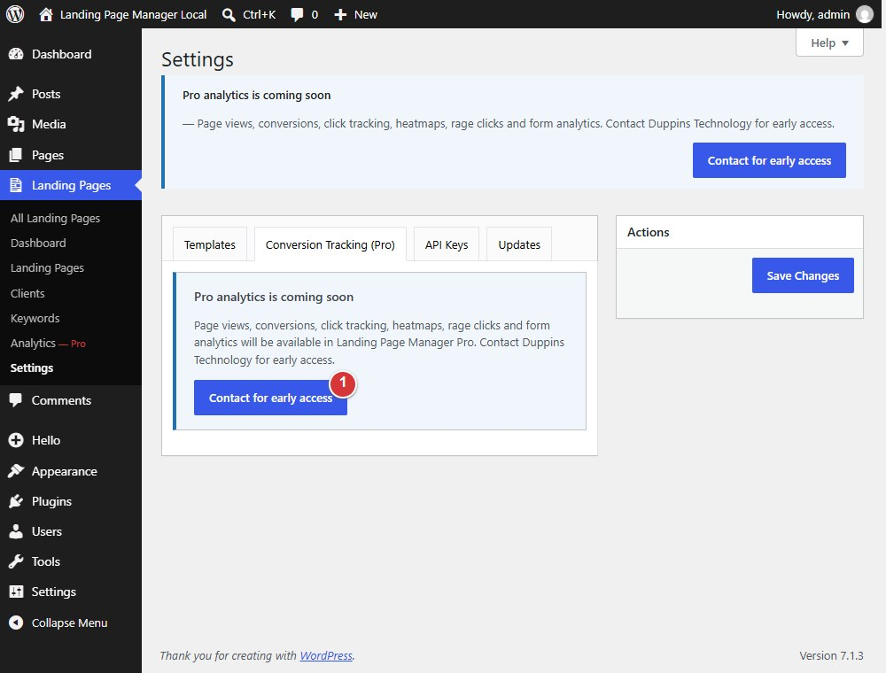

<!-- fragment: settings-conversion-tracking -->
<!-- screenshot: conversion-tracking.jpg -->

# Settings: Conversion Tracking (Pro)

Without the Pro add-on, **Landing Pages > Settings > Conversion Tracking (Pro)** displays an early-access notice; it does not provide tracking controls or collect analytics. The **Contact for early access** button opens the link configured by the plugin for Pro enquiries.

## Steps

1. Open **Landing Pages > Settings > Conversion Tracking (Pro)**.
2. Read the notice. Select **Contact for early access** to open the Pro enquiry link.

1. **Contact for early access** opens the plugin's configured Pro enquiry link.

Core does not include a Pro price or payment link.

## Next

[API Keys](settings-api-keys)
