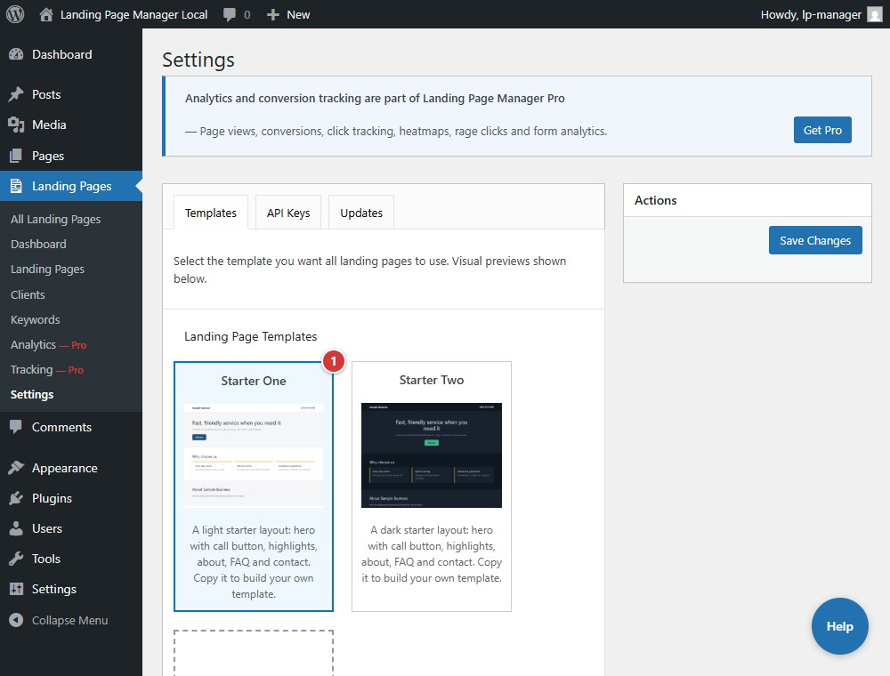

<!-- fragment: settings-templates -->
<!-- screenshot: templates.jpg -->

# Settings: Templates

**Landing Pages > Settings > Templates** selects the one template used by all landing pages on this site. The bundled choices are Template A, Template B, and Template C. This screen also accepts an owner-supplied template ZIP.

## Steps

1. Select one template card under **Landing Page Templates**, then select **Save Changes**.
2. To install a custom template, select **Upload New Template** and choose its ZIP. The ZIP must contain `single-landing_page.php` with a `Template Name:` header and `screenshot.png`, either at its root or inside one top-level folder.

Core has one site-wide template setting; template selection per client is not available. Uploaded templates are stored inside the plugin folder and are removed when the plugin updates. Keep the template ZIP to upload it again after an update.

1. Select a template card to choose the site-wide template.

## Next

[API Keys](settings-api-keys)
