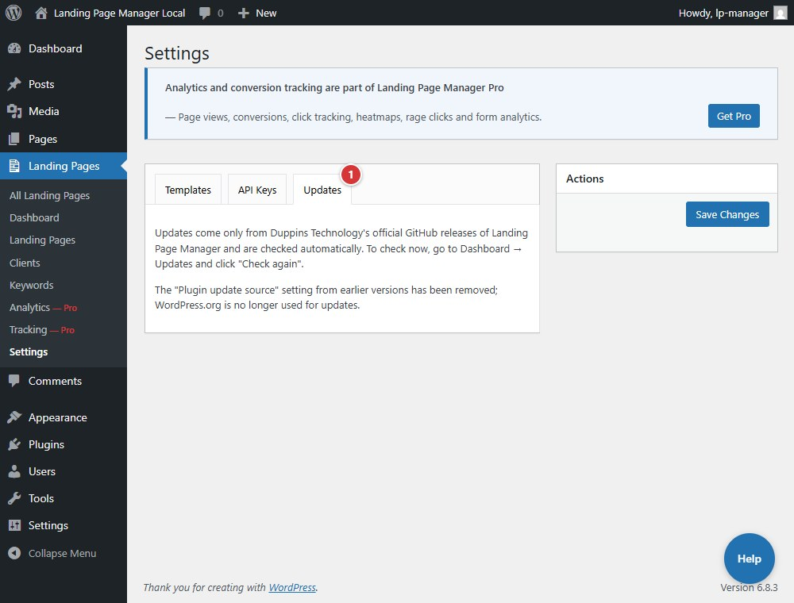

<!-- fragment: settings-updates -->
<!-- screenshot: updates.jpg -->

# Settings: Updates

**Landing Pages > Settings > Updates** explains that updates come from Duppins Technology's official GitHub Releases and are checked automatically. This tab does not have a manual update button.

## Steps

1. Open **Landing Pages > Settings > Updates** and read the update information.
2. To check now, open **Dashboard > Updates** and select **Check again**.

1. The **Updates** tab names GitHub Releases as the update source and points you to **Dashboard > Updates** to check for updates.

If you uploaded a custom template, keep its ZIP because plugin updates remove uploaded templates from the plugin folder.

## Next

[Deactivate](deactivate)
