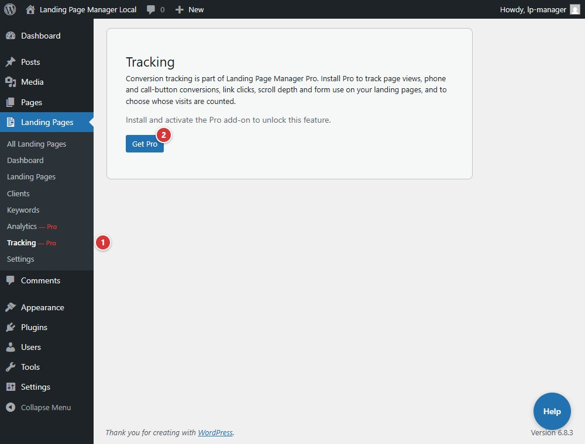

<!-- fragment: tracking -->
<!-- screenshot: tracking.jpg -->

# Tracking

**Landing Pages > Tracking** holds the conversion-tracking settings for your landing pages. The settings come from the separate Landing Page Manager Pro add-on, version 1.0.6 or later. Without Pro, the screen explains how to get conversion tracking, and the plugin tracks nothing.

## Steps

1. Open **Landing Pages > Tracking**.
2. If Pro is not active, read the notice. Select **Get Pro** to learn about the add-on. The core-only screen has no tracking controls.
3. When Pro is active, use **What is tracked** to turn each kind of tracking on or off. Conversion tracking (phone and call-button clicks) is always on.
4. Use **Who is tracked** to exclude internal traffic and bots, honor Global Privacy Control and Do Not Track, and wait for visitor consent. Select **Save Changes** to apply.

With a Pro version older than 1.0.6, this screen says where that version keeps its tracking settings. Update Pro to manage them here.

1. Select **Tracking** in the Landing Pages menu to open this screen.
2. **Get Pro** opens the page about Landing Page Manager Pro.

## Next

[Templates](settings-templates)
